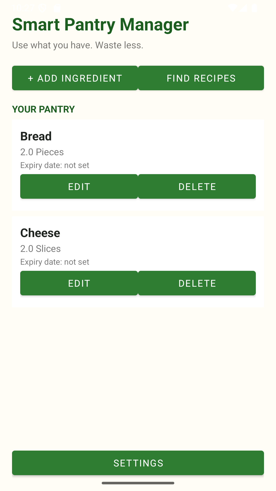
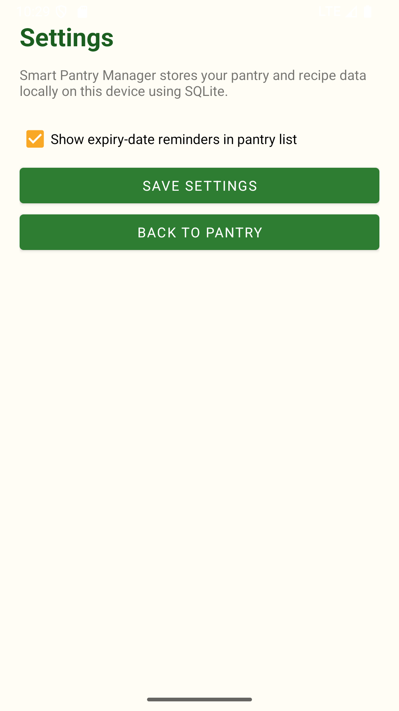

# Smart Pantry Manager

## 1. Project Overview

Smart Pantry Manager is an Android application developed in Java to help users manage ingredients stored in their pantry and discover recipes they can prepare using the ingredients they have available.

The application allows users to add, view, edit, and delete pantry ingredients. It also compares pantry quantities with recipe requirements to suggest meals that can be prepared without missing ingredients.

## 2. Project Objectives

The main objectives of Smart Pantry Manager are to:

- Make pantry ingredient management easier.
- Allow users to maintain accurate ingredient quantities.
- Store pantry information locally on the device.
- Suggest recipes based on available ingredients and quantities.
- Provide recipe details and preparation instructions.
- Demonstrate Android application development using Java and SQLite.

## 3. Features

### Pantry Management
- Add ingredients with a name, quantity, unit, and optional expiry date.
- View saved pantry ingredients.
- Edit existing ingredient information.
- Delete ingredients that are no longer needed.

### Recipe Suggestions
- Includes a database of 20 predefined recipes.
- Compares available pantry ingredients against recipe requirements.
- Checks ingredient quantities before suggesting a recipe.
- Supports ingredient name normalization to help match singular and plural forms.

### Recipe Details
- Displays recipe information and preparation instructions.
- Allows users to view details of suggested recipes.

### Settings
- Provides a settings screen within the application.

### Local Data Storage
- Uses SQLite to store pantry ingredients and recipe information.
- Keeps saved data available when the application is closed and reopened.

## 4. Technologies Used

- **Programming language:** Java
- **Development environment:** Android Studio
- **Database:** SQLite
- **User interface:** XML layouts
- **Lists:** RecyclerView with custom adapters
- **Navigation:** Android activities and intents
- **Version control:** Git and GitHub
- **Build system:** Gradle

## 5. Application Screens

The application includes the following main screens:

1. **Pantry Screen:** Displays saved ingredients and provides access to ingredient management.
2. **Add/Edit Ingredient Screen:** Allows users to enter or update ingredient details.
3. **Suggested Recipes Screen:** Displays recipes that match the available pantry ingredients.
4. **Recipe Details Screen:** Shows recipe information and preparation instructions.
5. **Settings Screen:** Provides access to application settings.

Screenshots of the running application can be added to this section after testing.

## 6. Database Design

The application uses SQLite with three main tables:

- **pantry:** Stores ingredient names, normalized names, quantities, units, and optional expiry dates.
- **recipes:** Stores recipe names and preparation instructions.
- **recipe_ingredients:** Stores the ingredients and required quantities associated with each recipe.

The `recipe_ingredients` table links to the `recipes` table using `recipe_id`. This structure allows one recipe to contain multiple required ingredients.

## 7. How Recipe Matching Works

The application checks each recipe against the ingredients saved in the pantry.

A recipe is suggested only when the pantry contains every required ingredient in a sufficient quantity. If an ingredient is missing or its quantity is insufficient, the recipe should not appear in the suggestions.

Ingredient names are normalized to help handle differences such as singular and plural forms.

## 8. Requirements

To open and run the project, you need:

- Android Studio.
- A compatible Java Development Kit.
- Android SDK components required by the project.
- An Android emulator or a compatible Android device.

## 9. How to Run the Project

1. Clone or download this repository from GitHub.
2. Open Android Studio.
3. Select **Open** and choose the project folder containing `settings.gradle`.
4. Allow Android Studio to synchronize the Gradle project.
5. Resolve any SDK installation prompts if they appear.
6. Start an Android emulator or connect an Android device with USB debugging enabled.
7. Click **Run** to build and launch the application.

The project uses Gradle for dependency management and building the Android application.

## 10. Testing

The following tests should be performed and documented:

- Add a new pantry ingredient.
- Edit an existing ingredient.
- Delete an ingredient.
- Close and reopen the application to verify data persistence.
- Confirm that a recipe appears when all required ingredients and quantities are available.
- Reduce an ingredient quantity and verify that a recipe requiring more than the available amount disappears.
- Restore the required quantity and verify that the recipe becomes available again.
- Open a suggested recipe and check its details.

Test results should reflect the actual behaviour observed during testing.

## 11. Project Structure

```text
SmartPantryManager/
├── app/
│   ├── src/
│   │   └── main/
│   │       ├── java/za/co/smartpantry/manager/
│   │       │   ├── DatabaseHelper.java
│   │       │   ├── Ingredient.java
│   │       │   ├── IngredientAdapter.java
│   │       │   ├── IngredientFormActivity.java
│   │       │   ├── PantryActivity.java
│   │       │   ├── Recipe.java
│   │       │   ├── RecipeAdapter.java
│   │       │   ├── RecipeDetailActivity.java
│   │       │   ├── SettingsActivity.java
│   │       │   └── SuggestedRecipesActivity.java
│   │       └── res/
│   └── build.gradle
├── gradle/
├── build.gradle
├── settings.gradle
├── gradlew
├── gradlew.bat
├── .gitignore
└── README.md
```

## 12. Future Improvements

Possible future improvements include:

- Barcode scanning for faster ingredient entry.
- Notifications for ingredients approaching their expiry dates.
- More recipes and recipe categories.
- Recipe search and filtering.
- Recipe quantity scaling.
- Cloud backup and synchronization.

## 13. Repository

GitHub repository: https://github.com/itsyopanda/SmartPantryManager

## 14. Author

Developed as part of an Android application development assignment.


## Application Screenshots

### Pantry Screen


### Add or Edit Ingredients


### Recipe Suggestions


### Recipe Details


### Settings

